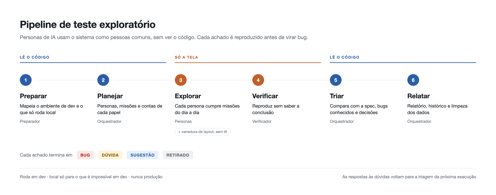

# Pipeline de teste exploratório com personas

Skill do Claude Code (`/teste-exploratorio`) e três agentes que usam um sistema como usuários comuns,
sem acesso ao código. Os achados são verificados e passam por uma triagem que consulta a especificação,
os bugs conhecidos e as decisões humanas anteriores. O relatório separa **BUG**, **DÚVIDA**,
**SUGESTÃO** e **RETIRADO**.



## Instalar

```bash
cd ~/Documents/pipeline-teste-exploratorio
./instalar.sh
```

O script liga `skill/teste-exploratorio` e `agents/*.md` ao `~/.claude` por links simbólicos e instala o
navegador dos agentes. Depois disso, a skill aparece em qualquer pasta onde o Claude Code for aberto, e
editar os arquivos deste repositório já vale na próxima execução.

## Usar

Abra o Claude Code **na pasta do sistema que vai ser testado**, de preferência numa sessão nova, e digite:

| Comando | O que faz |
|---|---|
| `/teste-exploratorio preparar` | Primeira vez (ou depois de mudar o pipeline): sobe o ambiente, cria usuários e dados, monta a base de conhecimento, escreve personas e missões e mostra o plano |
| `/teste-exploratorio rodar` | Usa o ambiente já preparado: monta o plano, mostra e, depois do seu ok, roda personas, varredura, verificação, triagem e relatório |
| `/teste-exploratorio relatorio` | Refaz só o relatório da última execução |
| `... modo=economico` | Personas com Haiku (mais barato) |
| `... modulo=Financeiro` | Restringe o escopo |

O pipeline **sempre mostra o plano e espera você mandar rodar** antes de soltar as personas.

Tudo o que é do produto fica no repositório dele, em `.exploratorio/`: `config.md`, `personas.md`,
`missoes.md`, `conhecimento/` (fontes, bugs conhecidos, decisões, telas), `historico.md` e
`execucoes/<data>/relatorio.md`.

Depois de revisar um relatório, diga ao Claude as decisões ("D-1 é intencional", "o BUG 2 não é bug
porque…"). Ele registra em `.exploratorio/conhecimento/decisoes.md`, e a próxima execução aplica sozinha.

## Estrutura

```
skill/teste-exploratorio/     a skill (ligada em ~/.claude/skills/teste-exploratorio)
  SKILL.md                    as 6 etapas do pipeline
  triagem.md                  árvore BUG / DÚVIDA / SUGESTÃO / RETIRADO e severidade
  personas.md                 base para montar personas (GenderMag + OCDE) e as 3 padrão
  missoes-e-tours.md          missões viáveis, campos de risco, cobertura, dados como as pessoas digitam
  formato.md                  formatos de achado, verificação, relatório, histórico e decisões
  varredura-layout.mjs        abre menus/seletores das telas e mede corte e rolagem (sem LLM)
  medir-tokens.py             consumo e custo por agente
  PESQUISA.md                 fundamentos e fontes
  diagrama.html               fonte do diagrama
agents/                       os 3 agentes (ligados em ~/.claude/agents)
  exploratorio-preparador.md  prepara e valida o ambiente e a base de conhecimento
  exploratorio-persona.md     usa o sistema como a persona (só navegador)
  exploratorio-verificador.md reproduz sem saber a conclusão, também do jeito comum
docs/                         resultados das execuções, lições aprendidas e análises
historico/                    backups de versões anteriores
```

## Execuções e lições

| Data | Produto | Resultado | Lições |
|---|---|---|---|
| 19/10/2026 | Dealto | 20 achados, sem revisão humana | `docs/` (relatório no repositório do Dealto) |
| 19/10/2026 | GD Ticket | 20 achados → 0 bugs na revisão humana | `docs/resultado-pipeline-teste-exploratorio.md`, `docs/melhorias-pipeline-teste-exploratorio.md` (lições 1 a 12) |
| 21/10/2026 | — | versão 2 aplicada | `docs/analise-pipeline-teste-exploratorio-v2.md` |
